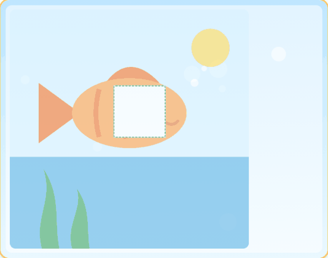

# Drag puzzle

## Description

A SurveyCTO field plug-in that turns a `select_one` question into a drag-and-drop puzzle game for young children. A picture with a missing piece is shown, and the child drags the right piece into the gap. It was built for early childhood development (ECD) assessments run on tablets, where the child plays and the survey runs quietly in the background.

The form stays simple. The picture goes in the question's image column, each piece is a choice with its own image, and the plug-in name goes in the appearance column. There are no calculations to write.

**[Download drag-puzzle.fieldplugin.zip](drag-puzzle.fieldplugin.zip)**

Requires a device whose browser engine supports Pointer Events and `element.animate()` (current Android System WebView and iOS 13.4 or later). Please confirm on your oldest tablet before fieldwork.

### Features

* Drag-and-drop puzzle with touch, snapping, and a gentle bounce back for wrong pieces
* Child-friendly feedback: pieces bounce in, the gap glows when a piece is close, and a correct piece triggers a star, confetti, a bounce, and a happy sound
* Sounds are generated by the plug-in, so no audio files are needed (can be muted)
* Five colour themes with a softly drifting background
* Tablet-first layout: landscape shows the picture on the left and the pieces in a column on the right, portrait shows the pieces below the picture. The whole puzzle fits the screen without scrolling.
* Practice mode with an animated hand that shows how to drag, more tries, and an enumerator restart button
* Optional audio instruction on the question (speaker button)
* Enumerator gear button to record "could not do it" or "refused"
* Saves the choice the child dropped, right or wrong, as normal `select_one` data
* Saves an optional log (attempts, order, time) as plug-in metadata
* A free puzzle maker page that cuts your picture into pieces and writes your form rows for you

### Data format

The field is a `select_one`. The stored value is the **value of the choice that the child dropped in the gap**. If the child drops the right piece, the right piece's value is stored. If the child drops a wrong piece, that wrong piece's value is stored. So every answer is a normal coded choice that exports like any other `select_one`.

By default only the first piece dropped is stored (`record='first'`), so later tries for the game do not change the scored answer. Use `record='last'` to store the final piece instead.

The special codes `96` ("could not do it") and `97` ("refused") are stored when the enumerator uses the gear button. Any choice with one of those values is hidden from the game, so you can list them in the choices sheet to give them labels.

The plug-in also keeps a log in its metadata, for example:

`v=1;status=correct;answer=3;correct=1;attempts=2;seq=3,1;moves=3;t_first=1.8;t_done=9.3;order=2,1,3,4`

Read it into your data with a calculate field: `plug-in-metadata(${your_field})`. The sample form shows this. See [docs/data-and-analysis.md](docs/data-and-analysis.md).

## How to use

### Getting started

1. Open [extras/puzzle-maker/puzzle-maker.html](extras/puzzle-maker/puzzle-maker.html) in any browser. It works offline.
2. Load a complete picture. Drag the green box over the part the child must find, and drag the red boxes to where the wrong pieces should come from.
3. Click **Download puzzle files (zip)**. You get the scene picture with the gap, one image per piece, and the rows to paste into your form.
4. Paste the survey row and the choices rows into your form definition. Make sure the picture files are attached to the form.
5. Attach [drag-puzzle.fieldplugin.zip](drag-puzzle.fieldplugin.zip) to the form as a field plug-in.
6. Test on a tablet.

To see a working example first, download the [sample form](extras/sample-form) and upload it to your SurveyCTO server. Attach the plug-in zip and all pictures from the `media` folder.

### Form setup

Survey sheet:

| type | name | label | media:image | appearance | required |
|---|---|---|---|---|---|
| select_one puzzle_1 | puzzle_1 | Say: "Find the missing piece." | puzzle_1_scene.png | custom-drag-puzzle(gap_x=43.3, gap_y=31.7, gap_w=22, correct=1) | yes |

Choices sheet (the game shuffles the pieces for each child):

| list_name | name | label | image |
|---|---|---|---|
| puzzle_1 | 1 | Correct piece | puzzle_1_p1.png |
| puzzle_1 | 2 | Wrong piece 1 | puzzle_1_p2.png |
| puzzle_1 | 3 | Wrong piece 2 | puzzle_1_p3.png |
| puzzle_1 | 4 | Wrong piece 3 | puzzle_1_p4.png |
| puzzle_1 | 96 | Child could not do it | |
| puzzle_1 | 97 | Child refused | |

The label is read by the enumerator. The scene picture must show the empty space. The puzzle maker produces the scene and the pieces for you. If you already have artwork cut into pieces, see [docs/making-a-puzzle.md](docs/making-a-puzzle.md).

### Parameters

Only the gap position is needed. Everything else has a default. Parameters go in brackets after the plug-in name, for example `custom-drag-puzzle(gap_x=44, gap_y=29, gap_w=22, correct=1, tries=2)`.

| Parameter | What it does | Default |
|---|---|---|
| `gap_x`, `gap_y` | Top-left corner of the gap, in percent of the picture width and height. The puzzle maker gives you these. | required |
| `gap_w` | Gap and piece width, in percent of the picture width | 22 |
| `gap_h` | Gap and piece height, in percent of the picture height | square on screen |
| `correct` | Value of the right choice | the choice with value 1, otherwise the first piece |
| `tries` | Pieces the child may drop before the item ends (1 to 9) | 1 (practice 9) |
| `record` | `'first'` stores the first piece dropped, `'last'` stores the final one | `'first'` |
| `practice` | `1` makes this a practice item: more tries, shows the answer, demo hand, restart button | 0 |
| `reveal` | `1` moves the right piece into the gap when tries run out | 1 for practice, else 0 |
| `demo` | `1` plays the hand demo once when the item opens | 1 for practice, else 0 |
| `hint` | Seconds of inactivity before the hand demo plays again, 0 for never. A hint shows the answer. | 0 (practice 8) |
| `theme` | `'sky'`, `'forest'`, `'ocean'`, `'candy'`, `'sunny'` | `'sky'` |
| `sound` | `0` mutes all sounds | 1 |
| `volume` | Sound volume from 0 to 1 | 0.7 |
| `confetti` | `0` turns off confetti | 1 |
| `shuffle` | `0` keeps the choice list order | 1 |
| `layout` | `'auto'`, `'stacked'` (pieces below), or `'side'` (pieces beside) | `'auto'` |
| `max_width` | Largest picture width in pixels | 720 |
| `code_cannot` | Value stored for "could not do it" | 96 |
| `code_refuse` | Value stored for "refused" | 97 |

### Default SurveyCTO feature support

| Feature / Property | Support |
|---|---|
| Supported field type(s) | `select_one` |
| Default values | Not recommended (a default value is treated as an answer already given and locks the puzzle) |
| Custom constraint message | Uses default behavior |
| Custom required message | Uses default behavior |
| Read only | Yes (shows the stored piece in the gap, pieces locked) |
| `randomized` appearance | Not used (the plug-in shuffles pieces itself, `shuffle=0` keeps list order) |
| media:image (question) | Yes (required, this is the puzzle picture) |
| media:audio (question) | Yes (adds a speaker button for an instruction recording) |
| media:video (question) | No |
| image (choices) | Yes (required, this is each piece) |
| `minimal`, `compact`, `quickcompact` appearances | Not applicable |

## Tablet layout

The plug-in measures the screen and makes the picture as large as it can while keeping the whole puzzle in view.

| Screen | Layout |
|---|---|
| Landscape tablet (for example 1280 x 800, 1024 x 768, 1024 x 600) | Picture on the left, pieces in a column on the right |
| Portrait tablet (for example 800 x 1280, 768 x 1024) | Picture on top, pieces in a row below |
| Phone | Picture on top, pieces below, may scroll a little |

Turning the tablet re-flows the layout. Use `layout='stacked'` or `layout='side'` to force one. Pieces are at least about 80 pixels wide on the tested tablet sizes, which is comfortable for small fingers.

## Testing status

Tested automatically (desktop Chromium with a mock of the SurveyCTO plug-in API, using the real sample form): 92 plug-in checks and 24 puzzle maker checks, including touch events, five tablet sizes in both orientations, rotation, saved answers, special codes, setup errors, and zip export. See [tests](tests).

**Not tested yet:** SurveyCTO Collect on real tablets, iOS, sound on device, form upload to a server, whether plug-in metadata appears in exports, screen readers, and play with children. Please run the checklist in [docs/field-testing-checklist.md](docs/field-testing-checklist.md) before any pilot.

## More resources

* [Making a puzzle](docs/making-a-puzzle.md): picture tips, using your own cut pieces, setting the gap by hand
* [Data and analysis](docs/data-and-analysis.md): what is stored, scoring, special codes, Stata examples
* [Assessment design notes](docs/assessment-guidance.md): practice items, avoiding cues, enumerator protocol
* [Testing checklist for tablets](docs/field-testing-checklist.md)
* [Development notes](docs/development.md): how the plug-in works, running the tests, rebuilding the zip
* [Sample form](extras/sample-form): three puzzles (practice, fish, house) with pictures
* [Puzzle maker](extras/puzzle-maker/puzzle-maker.html)
* [Field plug-in resources](https://github.com/surveycto/field-plug-in-resources): SurveyCTO developer documentation
* [Using field plug-ins](https://docs.surveycto.com/02-designing-forms/03-advanced-topics/06.using-field-plug-ins.html)
